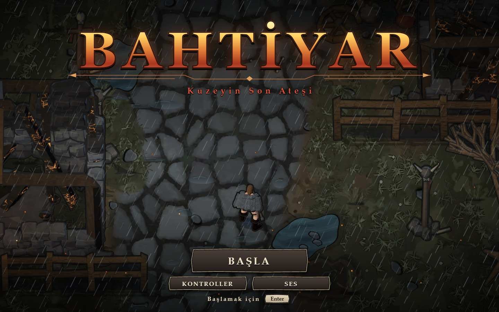
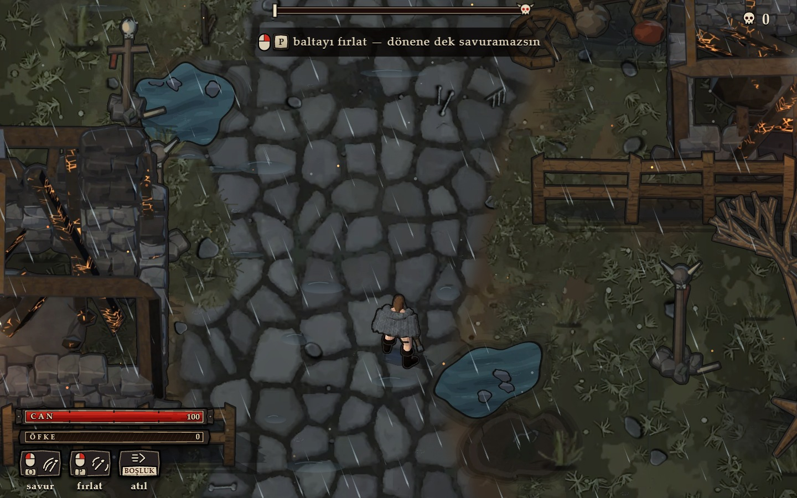
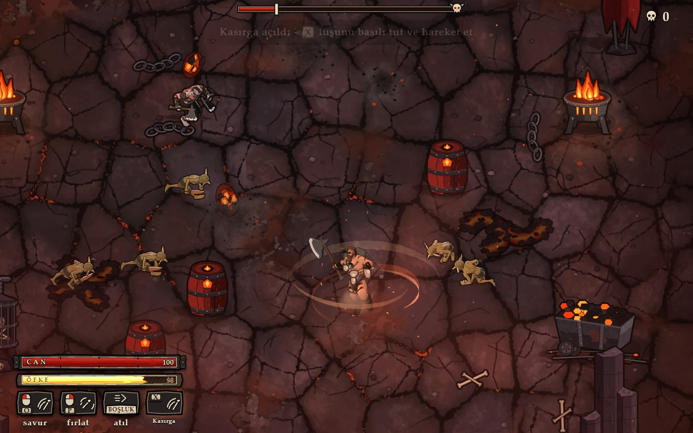
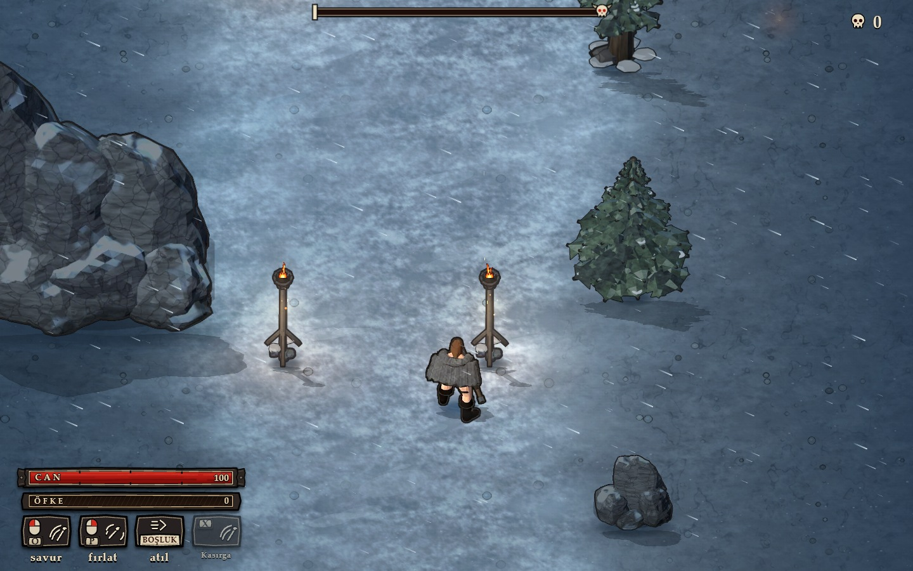

# Bahtiyar: Kuzeyin Son Ateşi 🪓

Bahtiyar, sağanak altındaki Yanık Köy’de kayıp bir kafilenin izini bulur. İzler onu kızıl maden ocaklarına, oradan da kuzey ordusuna işaret veren karlı bir hisara götürür. Fare ve klavyeyle oynanan bu Türkçe aksiyon oyununda baltayı savurur, fırlatıp geri çağırır ve biriktirdiğin öfkeyi iki farklı güç için kullanırsın.

**Yetişkinler içindir (18+). Kan ve yoğun şiddet içerir.**

**Oyna** · [Bahtiyar: Kuzeyin Son Ateşi](https://goktugkarpat.github.io/bahtiyar-kuzeyin-son-atesi/)

## Bölümler

| Bölüm | Ortam | Bölüm sonu düşmanı |
|---|---|---|
| I. Yanık Köy | Sağanak altında harabeler, yıkık kilise ve Kemik Çukuru | Gormagul |
| II. Kül Geçidi | Kızıl kül, maden ocakları ve Lav Köprüsü. Balta Atışı ve geri çağırma açılır. | Vargor |
| III. Ayaz Hisarı | Tipi, zincirli tutsaklar ve kuzey ordusunun işaret kulesi. Kasırga ve Savaş Öfkesi açılır. | Skarn |

| | |
|---|---|
|  |  |

## Nasıl açılır

- **Tarayıcıda** oyunu yukarıdaki bağlantıdan aç. İlk yüklemede görsellerin hazırlanması kısa bir süre alabilir.
- **Bilgisayarda** oyun klasöründeki `index.html` dosyasını tarayıcıyla aç. Kurulum gerekmez.
- **Sessiz açmak için** adresin sonuna `?sessiz` ekle. Mola ekranından ana ses, efekt ve müzik seviyelerini ayarlayabilirsin.

## Nasıl oynanır

**Başla** ile Yanık Köy’den gir. Yol boyunca düşman dalgalarını geç ve bölüm sonu düşmanını yen. Sağlık iksirleri düşmanlardan düşebilir.

| Kontrol | Ne yapar |
|---|---|
| W, A, S, D veya ok tuşları | Hareket et |
| Fare | Nişan al |
| Sol tık veya O | Baltayı savur |
| Sağ tık veya P | Baltayı fırlat veya geri çağır |
| Boşluk | Atıl |
| E | Öfke doluyken Savaş Öfkesi’ni aç |
| X (basılı tut) | Kasırga ile dönerek ilerle. Dönüş sürdükçe öfke harcarsın. |
| Esc | Mola |
| Shift + F | Çözünürlük ve FPS göstergesini aç veya kapat |

Başlık ve mola ekranındaki **Grafik** menüsünde iki seçenek bulunur. **Temel**, yönlü gölgeler ve her bölüme özgü ışıklandırma ile atmosferi kullanır. **Gelişmiş**, ıslak taşlarda meşale yansımaları, alev parlaması, buz parıltısı ve Kül Geçidi’nde yerel ısı dalgalanması ekler. Render ölçeğini profilden bağımsız olarak **1.00×**, **1.25×** veya **1.50×** seçebilirsin.

### Dövüş ve öfke

- Baltayı fırlattıktan sonra aynı tuşla geri çağır. Geri dönerken yolundaki düşmanlara da vurur. Kalkanlılara yandan yaklaşabilir veya ağır savurmayla savunmalarını açabilirsin.
- Yanık Köy’de savur ve atıl. Kül Geçidi’nde baltayı fırlatıp geri çağırabilir ve ağır vuruş yapabilirsin.
- Ayaz Hisarı’nda isabet aldığında veya vurduğunda öfke birikir. **Savaş Öfkesi** tam dolu çubuğu kullanır. Üçüncü bölümde açılan **Kasırga**, X’i basılı tuttuğun sürece aynı çubuktan harcar. Dönerken hareket edebilirsin.
- Şifa iksirleri düşmanlardan çıkar. Lav ve ateş alanlarının kenarından dolaş. Bölüm sonu düşmanını yenince sonuç ekranından sonraki bölüme geç.
- Mola menüsünden bulunduğun bölümü yeniden başlatabilir veya onay verip Yanık Köy’e dönebilirsin. Ana ses, efekt ve müzik ayrı ayarlanır.

## Müzik

Üç bölümün özgün müzikleri, keşif, savaş ve bölüm sonu karşılaşmalarına göre değişir.

- **Yanık Köy** · Ağır savaş yürüyüşü. Korno, çello ve deri davullar.
- **Kül Geçidi** · Yedi zamanlı ocak ritmi. Pes yaylılar, metal vurgular ve sert davullar.
- **Ayaz Hisarı** · Beş zamanlı kuzey ezgisi. Uzak nefesliler, koro ve düşük korno sesleri.

## Kaynaklar ve lisanslar

- Orkestra kayıtları S. Christian Collins’in [GeneralUser GS](https://www.schristiancollins.com/generaluser.php) enstrümanlarıyla bu oyun için üretildi. [Kullanım lisansı](https://github.com/mrbumpy409/GeneralUser-GS/blob/main/documentation/LICENSE.txt).

- Oyun [PixiJS](https://pixijs.com/) kullanır. Kütüphanenin MIT lisansı [vendor klasöründe](vendor/PIXI-LICENSE.txt) yer alır.
- Bahtiyar’ın [Barbarian modeli](https://opengameart.org/content/rigged-textured-barbarian) ve Gormagul, İnfazcı, Vargor, Buz Zırhlı Muhafız ve Skarn’ın [Executioner modeli](https://opengameart.org/content/rigged-textured-executioner) için özgün model atfı: **Model by thecubber, commissioned by the OpenGameArt.org community (https://opengameart.org).** Modeller [CC BY 3.0](https://creativecommons.org/licenses/by/3.0/) lisanslıdır. Bu oyunda oranlar, zırhlar, yüzeyler, silahlar ve pozlar değiştirilerek modeller sekiz yönlü 2B karakter karelerine dönüştürüldü.
- Bazı gövdeler, kıyafetler ve hareketler [Quaternius](https://quaternius.com/) paketlerinden ([CC0 1.0](https://creativecommons.org/publicdomain/zero/1.0/)). Viking sakalı ve bıyığı RehmanPolanski’nin [MakeHuman paketinden](https://static.makehumancommunity.org/assets/assetpacks/bodyparts05.html) (CC0 1.0).
- Savaş narası Welvyn Z. Porter’ın [Kingly Yell](https://freesound.org/people/WelvynZPorterSamples/sounds/623449/) kaydından düzenlendi (CC0 1.0).

## Yapım ve katkılar

Oyunun fikri, yönü ve oynanış kararları **Göktuğ Karpat**’a aittir. Oyun geliştirme ve cila çalışmalarında **Claude Code** (Anthropic) ve **Codex** (OpenAI) kullanıldı. Kâr amacı taşımayan kişisel bir projedir.
